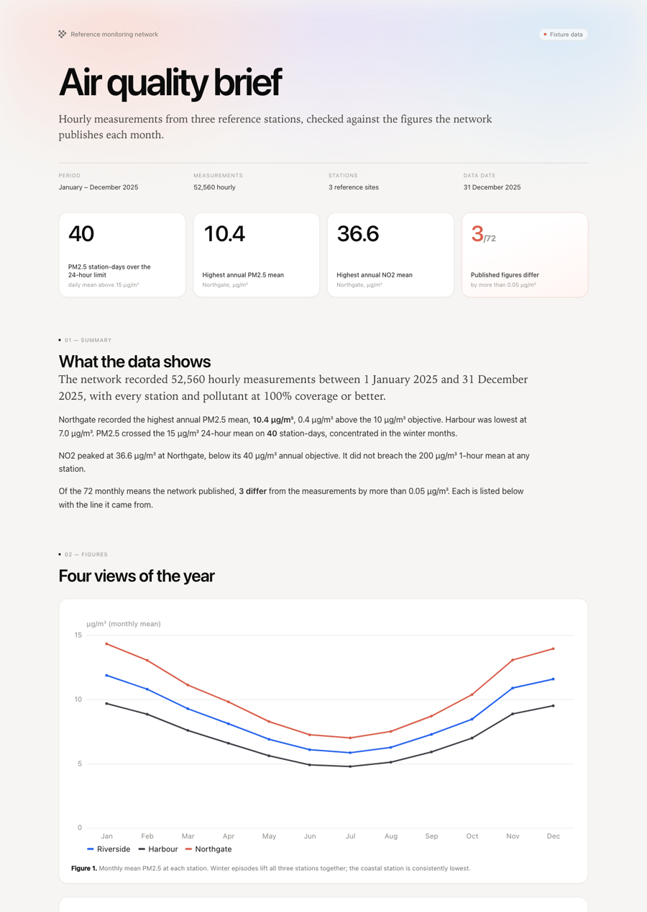

# Source to report

A complete, independently runnable Phlo lakehouse: raw sources in, checked
insights and a report out. Two packs run through the same pipeline:

* **Air quality**: do the figures the network publishes match its own
  measurements?
* **YouTube**: what did one channel publish in 2025, and how did the audience
  respond?

```
source ──▶ evidence ──▶ insight ──▶ analysis ──▶ report
```

The air pack is the reference. Its source is hourly readings from three
monitoring stations, and the network's twelve published monthly notes.
* **Evidence**: every reading validated against a Pandera contract; daily and
  monthly means built in dbt.
* **Insight**: each published figure extracted with its note and line, so it
  can be checked rather than trusted.
* **Analysis**: annual means against the objectives, exceedance days,
  coverage, and a reconciliation of all 72 published figures.
* **Report**: one self-contained HTML page with charts, a claims table, the
  build's provenance, and every input pinned by SHA-256.



Everything runs on DuckDB with no services and no API keys. The same fixtures,
ingestion assets and dbt project run on the full stack (Trino, Iceberg,
Dagster) with `phlo materialize`.

## What you get

After a build:

| Path | What it is |
| --- | --- |
| `reports/index.html` | The brief. Opens offline; no external assets. |
| `reports/summary.json` | Every number the report quotes. |
| `reports/provenance.json` | Inputs and hashes, package versions, git commit. |
| `reports/data/*.csv` | The five tables the report reads. |
| `reports/charts/*.svg` | The four figures, as standalone files. |
| `reports/youtube/index.html` | The YouTube brief, built by `uv run youtube-insights`. |
| `build/source_to_report.duckdb` | The local warehouse, if you want to query it. |

Expected result on the shipped fixtures: 52,560 readings, 12 notes, 72
published figures checked, 3 of them differing from the measurements (seeded
on purpose), and 40 PM2.5 station-days over the 24-hour objective.

## Two packs, one pipeline

Both pages are built by the same stages. The runners differ only in which
pack they hand to those stages: a reader, a Pandera contract, dbt models, the
questions, and a page.

| Pack | Input | Build | Page |
| --- | --- | --- | --- |
| Air quality | `data/raw/` and `data/notes/` | `uv run source-to-report` | `reports/index.html` |
| YouTube | `data/youtube/channel.json` | `uv run youtube-insights` | `reports/youtube/index.html` |

The YouTube pack publishes 24 videos in 2025: 331,139 views, 5.1% median
engagement, and a ranked list of the five that travelled. It runs through the
same `load_assets` → `run_dbt` → `Warehouse` → `Facts` → `render` path.

## Run it

You need [`uv`](https://docs.astral.sh/uv/) and Python 3.12 (uv installs it).
No Docker, no keys.

```bash
uv sync --locked --group dev
uv run source-to-report
open reports/index.html      # xdg-open on Linux
```

The first run generates the deterministic source pull if it is missing. A
rebuild takes about twenty seconds.

Useful flags:

```bash
uv run source-to-report --regenerate-fixtures   # rewrite the pull, then rebuild
uv run source-to-report --out /tmp/brief        # write somewhere else
uv run source-to-report --verbose               # show dbt's model-by-model output
```

## Run it on the full stack

The local runner is not a separate implementation. It calls the same
`@phlo.ingest.dlt` assets, validates the same Pandera contracts, and runs the
same dbt project the orchestrator does.

```bash
uv run phlo services init --force --no-dev
uv run phlo services start --build
uv run phlo doctor
uv run phlo materialize --select "*" --partition 2025-12-31
uv run python scripts/verify_stack.py
```

The wildcard is deliberate: the project's assets span ingestion, dbt and the
report, and Dagster builds them in dependency order. The marts land in
`analytics`; the dlt assets own `raw`. The report is then produced by the
report asset, which reads the marts through Trino, and lands in `reports/`
with `"warehouse": "trino"` in its provenance.

`scripts/verify_stack.py` checks the stack result against the same generator
manifest the local proof uses: annual means, the three seeded discrepancies,
coverage, row counts and the report's provenance.

```text
  CHECK                                   RESULT  DETAIL
  report came from the stack              PASS    trino
  annual means match the generator        PASS    6 rows, within 1e-6
  all published figures present           PASS    72
  only the seeded figures differ          PASS    3 differing
  coverage is complete                    PASS    >= 95%
  every month is complete                 PASS    72 monthly rows
  summary counts match                    PASS    52,560
  report is self-contained                PASS    129 KB
  report carries the same figures         PASS    3 sources
  9/9 stack checks passed
```

## Adapt it

This preset is a worked example of a generic pattern. The spine — runner, dbt
invocation, warehouse access, provenance, strict facts, charts, renderer —
contains no domain vocabulary. Everything specific to air quality is in one
place per layer, and [DOMAIN.md](DOMAIN.md) is the checklist for replacing it.

The short version:

1. `src/source_to_report/domain/` — vocabulary, extraction, analysis, report template.
2. `workflows/` — ingestion assets, Pandera contracts, dbt models.
3. `data/` and `scripts/generate_fixtures.py` — the deterministic pull.
4. `scripts/verify.py` — the ground-truth checks for your domain.

The rules that keep it useful:

* **A build is deterministic.** Same pull, same bytes. No wall clock in the
  report; the run record is the only file allowed to differ.
* **The report never invents a number.** Prose looks numbers up through
  `Facts`; a missing table, column or row fails the build.
* **Strict is better than silent.** A published figure that cannot be parsed
  stops the run instead of disappearing from the reconciliation.

## Proof

```bash
uv run pytest                     # 37 tests: fixtures, contracts, extraction, charts, facts, both packs
uv run python scripts/verify.py   # 9 end-to-end checks, including two byte-identical builds
uv run python scripts/verify_stack.py   # 9 checks against the Trino/Iceberg build
```

`scripts/verify.py` builds the lakehouse twice into `build/verification/a` and
`build/verification/b`, hashes every reader-facing artefact, and compares the
results with the generator's independent ground truth:

```text
  CHECK                                     RESULT  DETAIL
  two builds are identical                  PASS    11 reader-facing files
  readings match the pull                   PASS    52,560
  claim count matches                       PASS    72
  only the seeded figures differ            PASS    3 differing, 3 seeded
  annual means match the generator          PASS    within 1e-6
  all summary checks pass                   PASS    3 checks
  report is self-contained                  PASS    129 KB
  every seeded source line is in the report PASS    3 lines
  provenance pins every input               PASS    1 pull + 12 notes
```

## Layout

```text
src/source_to_report/
  cli.py, runner.py           command line and the air pack's end-to-end build
  pipeline.py                 load -> dbt -> analyse, shared by both packs
  ingest.py, dbt.py           local execution of the Phlo assets and dbt project
  warehouse.py                read-only SQL, DuckDB locally and Trino on the stack
  provenance.py               input hashes and the run record
  facts.py                    strict lookups used by the report
  charts.py                   Altair chart definitions, rendered to static SVG
  youtube/                    the second pack: reader, analysis, page, runner
  report.py                   Jinja renderer and the self-contained check
  domain/                     the domain pack: vocabulary, sources, extraction,
                              analysis and report.html.j2
workflows/
  ingestion/monitoring.py     three Phlo dlt assets
  ingestion/youtube.py        the channel export asset
  schemas/monitoring.py       Pandera contracts
  transforms/dbt/             sources, staging and marts
  analysis.py                 the air report as a Phlo asset
  youtube_analysis.py         the channel report as a Phlo asset
  plugin.py                   asset discovery
scripts/
  generate_fixtures.py        the air pull and its manifest
  generate_youtube_fixtures.py  the channel export
  verify.py                   the air end-to-end proof
tests/                        fixtures, contracts, extraction, charts, facts, pipeline, reproducibility
```

## Scope

* The fixtures are synthetic and labelled as such in the report.
* The pipeline is the product; the two packs are worked examples, not a fixed
  schema. Adapt a pack, or add a third beside them.
